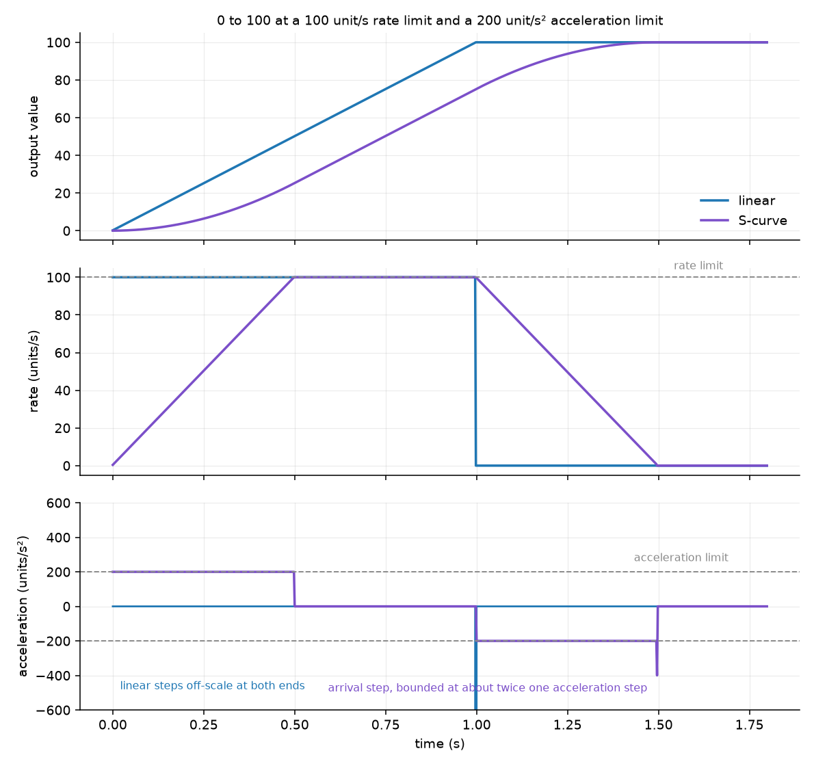
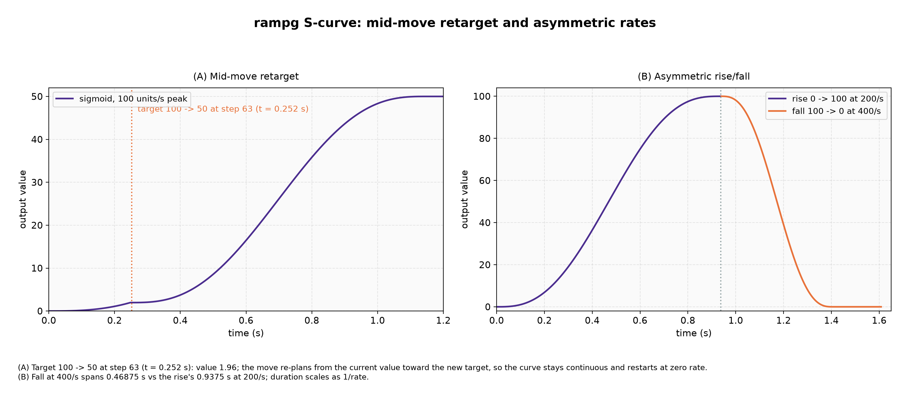

# Design

This document explains how `rampg` shapes a move, what each profile guarantees, the limits of its `float` arithmetic, and how the library is verified. Function behaviour is in [api.md](api.md).

## Goals

- Move one `float` output toward a target at a bounded rate, one caller-timed step at a time, in any unit.
- Keep the output rate continuous when the target, rates, limits or profile change in the middle of a move, so a live setpoint can drive the ramp directly.
- Never overshoot the target, never leave the output limits, and land exactly on the target.
- Contain bad time steps and non-finite values inside the update instead of corrupting the state.
- Do bounded, constant work per update, with caller-owned storage and no allocation.

## Non-goals

- **Time source.** The caller measures time and passes the step.
- **Runtime argument checks.** Preconditions on the setters are contracts, as for any C library function.
- **Arbitrary profiles.** Only linear and S-curve shapes are provided; exponential or table-driven shaping belongs in the application.
- **Jerk limiting.** The S-curve bounds the rate and its rate of change, not the change in acceleration.
- **Thread safety.** An instance shared across threads or with an interrupt handler needs the caller's mutual exclusion.
- **Persistence.** Saving and restoring ramp state is the application's concern, though `rampg_t` can be copied with `memcpy`.

## State

An instance holds its output `value`, the unclamped `target`, per-direction rates and accelerations, the output limits, the profile, the enabled flag, and the output rate `vel`. There is no plan and no move clock: every update works from the current value and rate only, which is what lets any parameter change between updates without restarting the move.

The **effective target** is the stored target clamped to the output limits. Every update moves toward it, and `rampg_at_target` and `rampg_get_state` compare against it. Keeping the stored target unclamped means that widening the limits later recovers the original intent. The direction of the move, toward the effective target, selects which rate and acceleration apply, including through a reversal.

## Linear profile

The linear profile moves at the configured rate for the direction of travel until it reaches the effective target, then stops. The rate steps from zero to the full rate at the start of a move and back to zero at the end.

When `rate * dt` is below the resolution of the output, a plain `value += rate * dt` would round to no movement at all and the ramp would stall. The profile instead adds each update's movement to a budget and moves the output by the whole budget. When rounding to a representable `float` would spend more than the budget, it steps back one value toward the current output with `nextafterf`, and carries the unspent fraction to the next update. The visible output may hold for several updates, but the average rate over many updates is the configured rate and the move lands exactly. The budget is a `float` too, so the limits of this scheme are given under [Numerical range](#numerical-range).

## S-curve profile

A linear move steps its rate at both ends. For a physical actuator (a motor, a valve, a power supply) those steps are impulsive: they excite mechanical resonance, drive current into inductive loads, or trip a soft limit. The S-curve profile also bounds how fast the rate itself changes. The rate starts at zero, rises to the configured rate, holds through the middle of the move, and falls back to zero, so the output eases in and out instead of stepping.

The cost is time. A move long enough to reach the configured rate takes `rate / accel` seconds longer than the linear move: half that easing in and half easing out. This is a fixed overhead set by the two limits, not a multiple of the move length.

### Move duration

Let `d` be the distance, `r` the rate limit and `a` the acceleration limit. If the move is long enough to reach `r`, the rate profile is a trapezoid and the move takes

$$
t = \frac{d}{r} + \frac{r}{a}
$$

Otherwise the ramp reaches only $\sqrt{a d}$ before it must brake, the rate profile is a triangle, and the move takes

$$
t = 2\sqrt{\frac{d}{a}}
$$

The changeover is at $d = r^2 / a$. A move from 0 to 400 at 50 units/s and 200 units/s² takes 8.25 s, against 8 s for the linear move.

### Asymmetric legs

A rise and a fall often have different jobs. A DC bus is eased up under control and tripped down on a fault; a drive is accelerated gently and stopped hard. Asymmetric rates alone are not enough, because a single acceleration limit then serves both legs: one gentle enough for the rise makes the trip take seconds, and one fast enough for the trip makes the rise step rather than ease. Setting the accelerations per direction resolves it. For a 400 V bus at 50 V/s up and 2000 V/s down:

| Configuration | Rise 0 to 400 | Trip 400 to 0 |
| --- | --- | --- |
| Symmetric acceleration 100 V/s² | 8.50 s | 4.00 s |
| Symmetric acceleration 20000 V/s² | 8.00 s | 0.30 s |
| 100 V/s² up, 40000 V/s² down | 8.50 s | 0.25 s |
| Linear | 8.00 s | 0.20 s |

The first configuration cannot trip, the second cannot ease, and the third does both.

### Update steps

The rate and acceleration below are the pair for the direction of the move. Each update does three things.

1. **Approach the cruise rate.** The rate moves toward the rate limit, in the direction of the target, by at most one acceleration step:

   <!-- snippet: skip -->
   ```c
   want = copysignf(rate, target - value);
   vel += clamp(want - vel, -accel * dt, accel * dt);
   ```

2. **Stay inside the braking envelope.** The rate is clamped to $\pm v_b$, the greatest speed from which the ramp can still stop exactly on the target without exceeding the acceleration limit.

3. **Advance the output.** `value += vel * dt`, snapping to the target if the step reaches or passes it.

### Braking envelope

The update applies the new rate to the value within the same tick. A ramp travelling at $v$ that decelerates at $a$ from here on advances by $v$, then $v - a\,dt$, then $v - 2a\,dt$, down to zero. Over the $n = v / (a\,dt)$ steps this takes, the distance covered is

$$
d(v) = dt \sum_{k=0}^{n} (v - k\,a\,dt) = \frac{v^2}{2a} + \frac{v\,dt}{2}
$$

The envelope is the inverse: the greatest $v$ whose stopping distance fits in the distance remaining. The positive root of $v^2 + a\,dt\,v - 2ad = 0$, rationalised to avoid the cancellation the direct form suffers as $d$ approaches zero, is

$$
v_b(d) = \frac{-a\,dt + \sqrt{(a\,dt)^2 + 8ad}}{2} = \frac{4ad}{a\,dt + \sqrt{(a\,dt)^2 + 8ad}}
$$

The denominator of the rationalised form is at least $2a\,dt$, so the expression is defined for any $a > 0$ and $dt > 0$ and needs no special case at $d = 0$.

### Clamp, not target

Using $v_b$ as the rate to aim for, with the acceleration limiter walking toward it, is unstable at the end of a move. Write the tracking error as $e = v - v_b$. Because $v_b$ falls with the remaining distance, and the distance falls in proportion to the current speed, the error obeys

$$
\frac{de}{d\,\text{step}} \approx \frac{a\,dt\,e}{v_b}
$$

which grows without bound as $v_b$ falls to zero. A limiter that is exactly critical cannot recover from any error, and `float` rounding alone introduces one, so the ramp would arrive at the target at many times one acceleration step instead of coming to rest on it.

Clamping removes the feedback. The state is always on or inside the envelope, so there is no error to accumulate, and the envelope only ever reduces the rate.

### Landing

A move ends in one of two ways. Normally the step reaches or passes the target and the ramp snaps to it, which is what makes `rampg_at_target` exact.

The second case is numerical. Once a step falls below the resolution of the output, the value stops changing however many updates pass. When the envelope is the constraint binding the rate, the rate can only fall further and the target can never be reached by accumulation, so the ramp lands on it. When another limit is binding, the rate is still rising and will clear the resolution floor, so the ramp holds and carries on. This distinction keeps a ramp from stalling just short of its target, and from jumping the whole remaining distance at the start of a move that begins from a large value.

### Guarantees

For any rate, acceleration and `dt` greater than zero, and whatever the caller does to the target, rates, limits or profile between updates:

- The output rate never exceeds the rate limit for its direction.
- The output never overshoots the effective target and never leaves the limits.
- The output rate is continuous across a change of target, rate, acceleration or limits, and across a switch from the linear profile.
- The output arrives exactly on the effective target.
- The output rate changes by at most `accel * dt` per update in real arithmetic. In `float`, the envelope clamp rounds past this in the last few resolution steps before the target. A randomised sweep of twenty thousand moves, spanning rates of 0.5 to 1000, accelerations of 5 to 20000 and steps of 0.1 to 20 ms, measured at most 1.99 times `accel * dt`, and the unit tests assert twice `accel * dt` on every update.
- On the update that arrives, the rate falls to zero from a small value. Let $q$ be the spacing of `float` values at the target. The same sweep measured that value at no more than 1.5 times the largest of $2a\,dt$, $\sqrt{2aq}$ and $q / dt$. The first term dominates unless $a\,dt^2$ is small next to $q$.

One exception applies to the acceleration bound. If the target moves to a point inside the current braking distance, no bounded deceleration can stop there. The generator prioritises not overshooting: it decelerates as hard as the envelope demands and stops on the target. An application that would rather overshoot and come back than exceed the acceleration limit should keep the target outside the braking distance $v^2 / (2a)$, which `rampg_get_rate` provides the inputs for.

### Profile changes

Switching from linear to S-curve seeds the S-curve with the rate the linear ramp was running at, so the rate is continuous. Switching from S-curve to linear resumes at the full configured rate, which is the step every linear move has. `rampg_reset`, disabling, and a limit change that displaces the output all set the rate to zero, because the output is then at rest or was moved rather than ramped.

### Graphs

`docs/plot_scurve.py` compiles the library and drives it through `ctypes`, so the graphs show the library's behaviour rather than a re-derivation of it. Regenerate them with `uv run docs/plot_scurve.py`.



A move from 0 to 100 at a 100 units/s rate limit and a 200 units/s² acceleration limit, sampled every 2 ms.

- **Value** (top). The linear trace reaches 100 at 1.0 s. The S-curve eases away from 0, runs straight through the middle, and eases into 100 at 1.5 s; the extra 0.5 s is `rate / accel`.
- **Rate** (middle). The linear trace is a rectangle. The S-curve trace is a trapezoid that reaches the same 100 units/s peak, because the rate limit means the same in both profiles.
- **Acceleration** (bottom). The S-curve trace sits on ±200 while easing and at zero while cruising. The linear trace has no bound, so its steps at both ends run off the scale. The small step at the end is the arrival, at twice one acceleration step.



- **(A) Retarget and reversal.** The move starts toward 100. At 0.5 s the target moves to 160, and at 1.2 s to -40, behind the current value. The rate holds at the limit through the retarget, then walks down through zero at the acceleration limit and back up to the limit in the opposite direction, without restarting or stepping.
- **(B) Asymmetric rise and fall.** A move from 0 to 200 at 50 units/s up and 150 units/s down, with 100 units/s² up and 600 units/s² down. Each leg cruises at its own rate and eases at its own acceleration, so the corners of the two rate traces have different slopes.

## Enable and disable

A disabled ramp holds its output and reads a zero rate. Disabling also clears the stored rate, because a held output is at rest; re-enabling therefore eases away from rest under the S-curve profile. The target, rates, accelerations, limits and profile are kept, so a target set while disabled applies on resume. `rampg_get_state` reports `RAMPG_STATE_DISABLED` whatever the position, while `rampg_at_target` stays positional.

## Numerical range

The output is a `float`, so how far a single update can move it depends on its magnitude.

- Under the linear profile, the movement budget is a `float` and stops growing once `rate * dt` falls below its own resolution. A move keeps progressing while `rate * dt` stays above about $2^{-47}$ of the output magnitude. Far below that the output holds indefinitely while `rampg_get_state` still reports `RAMPG_STATE_MOVING`.
- Under the S-curve, the landing rule above applies when the braking envelope falls below the output's resolution.
- Keep the ratio of output magnitude to per-update step within about $10^6$ when the output must change on every update.

## Cost per update

An update does a fixed amount of work with no loops. The S-curve profile evaluates one `sqrtf` per update for the braking envelope, which dominates the call on a target without hardware floating point or a hardware square root. The linear profile has no square root, and calls `nextafterf` only when rounding would overspend its movement budget.

## Memory and threading

`rampg_t` is a plain struct of nine `float` values, an enum and a `bool`; it is 44 bytes on a 64-bit Linux host. The library has no global state, so separate instances need no coordination. One instance must not be updated and configured concurrently without the caller's mutual exclusion.

## Verification

- `test_rampg` covers both profiles, retargets, reversals, rate, acceleration, limit and profile changes in the middle of a move, containment of invalid inputs, enable and disable, and property sweeps that check the rate, acceleration and limit bounds on every update. CI runs it under ASan and UBSan with GCC, and builds the library in a release configuration.
- A coverage job enforces 100% line and branch coverage of `src/` and `include/`.
- The documentation examples are compiled by the `rampg docs examples` test.
- CI compiles the library with TI C2000 CGT 22.6.2 and 25.11.1 under COFF and EABI, with `--float_support=fpu32` and warnings as errors.
- `scripts/format.sh --check` enforces the pinned clang-format.
- `misch` checks MISRA C:2023 for the x86_64 and AArch64 profiles against committed baselines. The version macros in `rampg.h` carry an inline deviation of Rule 2.5 (unused macro), because they exist for consumers and the library does not use them.
